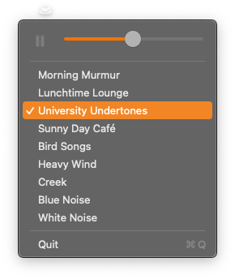

# ☕ Coffitivity Local

A tiny, native macOS menu-bar app that loops the free coffee-shop ambience from
[Coffitivity](https://coffitivity.com), the background buzz that helps you focus.
It plays right from your menu bar and keeps working offline.

<p align="center">
  
</p>

> Powered by the free library at
> **[coffitivity.com/library/free](https://coffitivity.com/library/free)**.
> For more sounds and the full experience, visit
> **[coffitivity.com](https://coffitivity.com)**. There is a link right in the menu.

## Why

A little ambient noise, like the gentle murmur of a café, can help you settle in
and focus. Coffitivity Local brings that ambience to your menu bar with no browser
tab, no account, and no Dock clutter. Click the cup, press play, and get to work.

## Features

- **Lives in the menu bar.** No Dock icon and no window. The cup fills while a
  sound is playing and shows its outline when idle.
- **One-click play and pause.** A large play/pause button and the volume slider
  sit together at the top of the menu.
- **Resumes where you left off.** It remembers the last sound you played and
  brings it back on the next launch.
- **Works offline.** Each sound downloads and caches the first time you play it,
  then plays from disk every time after.
- **The full free library.** All nine free Coffitivity tracks, looped seamlessly.
- **Lightweight and native.** Pure Swift, AppKit, and AVFoundation, with no
  third-party dependencies.

## Install

Requires macOS 13 or later and a Swift 5.9 or later toolchain (Xcode or the
Swift toolchain).

From the project root:

```bash
./make-app.sh
open CoffitivityLocal.app
```

`make-app.sh` builds a release binary and bundles it into `CoffitivityLocal.app`.
Drag it to `/Applications` to keep it around, and add it under
**System Settings → General → Login Items** to start it at login.

## Using it

Click the ☕ cup in the menu bar:

- **▶ / ⏸** plays or pauses the current sound, resuming from where it paused.
- **Volume slider** sets the level, and it is remembered across launches.
- **Pick a sound** to loop any of the nine. A ✓ marks the current one.
- **More sounds at coffitivity.com ↗** opens the full site in your browser.
- **Quit** (⌘Q).

Cached audio lives in `~/Library/Application Support/CoffitivityLocal/`.

## Develop

```bash
swift test                    # run the CoffitivityKit unit tests
swift run CoffitivityLocal    # run without bundling into an .app
```

The code splits into a testable `CoffitivityKit` library, which holds the sound
list, disk cache, audio player, and a pure `PlaybackState` decision model, and a
thin `CoffitivityLocal` executable that wires up the menu bar.

## Scope

Coffitivity Local plays the free Coffitivity library only. It has no mixing, no
accounts, and no premium sounds, in keeping with YAGNI. For those, the in-menu
link takes you to the full site.

## Credits

All audio and the Coffitivity name belong to
**[Coffitivity](https://coffitivity.com)**. This is an unofficial, personal
menu-bar player for their freely available tracks, and it is not affiliated with
or endorsed by Coffitivity. If you enjoy it, support the original at
[coffitivity.com](https://coffitivity.com).
